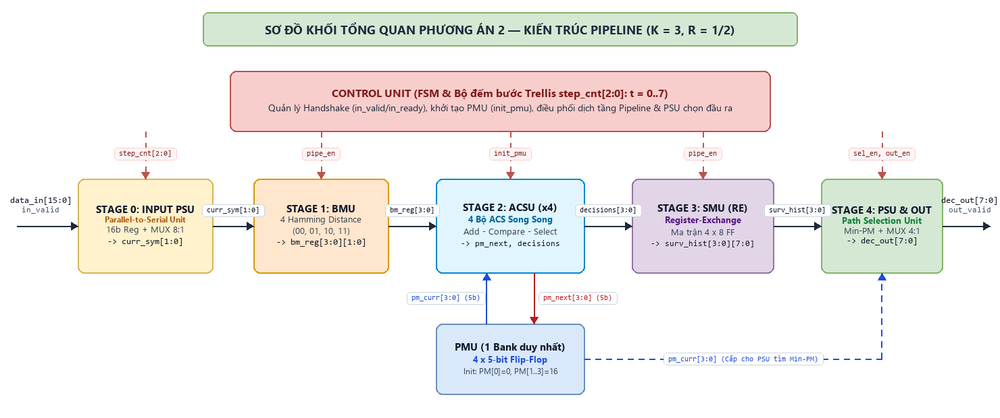
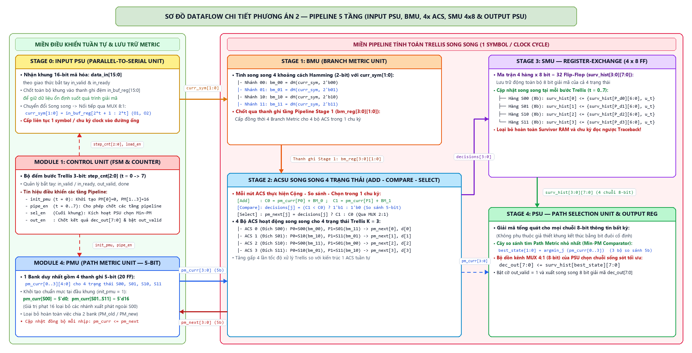
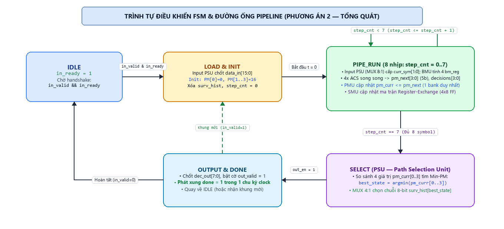

# 4. Phương án Pipeline cải tiến (Phương án 2 — Kiến trúc Tổng quát)

> **Nhận xét:** Phương án đề xuất 1 sử dụng chung 1 bộ ACS duy nhất tuy giảm số cổng logic tổ hợp nhưng thiết kế FSM phức tạp (14 trạng thái), cần 2 bank nhớ Path Metric và Survivor RAM đọc ngược nên độ trễ lớn, hiệu suất chưa cao với bài toán $K = 3$.  
> **Từ đó, nhóm đề xuất Phương án 2:** Sử dụng kiến trúc **Pipeline 5 tầng** gồm khối chuyển đổi song song - nối tiếp đầu vào (**Input PSU**), **BMU**, **4 bộ ACS song song** (tối ưu cho $K = 3$), bộ nhớ **Path Metric 1 bank (5-bit)**, truy vết động bằng ma trận **Register-Exchange $4 \times 8$ Flip-Flop (SMU)** và khối chọn đường tối ưu **PSU (Path Selection Unit — Min-PM)** ở đầu ra, đáp ứng giải mã tổng quát cho mọi khung dữ liệu 16-bit mã hóa sang 8-bit thông tin.

---

## A. Thiết kế sơ đồ khối tổng quan

| Khối (Phương án 2) | Nhiệm vụ | So sánh với Thiết kế 1 |
| :--- | :--- | :--- |
| **Stage 0: Input PSU & FSM** *(Parallel-to-Serial Unit & Control Unit)* | Chốt khung 16-bit `data_in[15:0]` khi bắt tay `in_valid/in_ready`, tuần tự hóa thành từng cặp 2-bit `curr_sym[1:0]` qua MUX 8:1 theo `step_cnt[2:0]` ($t = 0\dots 7$) và cấp tín hiệu điều khiển các tầng pipeline. | Tích hợp bộ chuyển đổi song song sang nối tiếp (Input PSU) nhận trọn gói 16-bit; FSM chỉ điều phối luồng dữ liệu liên tục, không phải duyệt chỉ số trạng thái `s_idx`, không quản lý địa chỉ RAM và không cần trạng thái chuyển bank. |
| **Stage 1: BMU** *(Branch Metric Unit)* | Tính song song 4 khoảng cách Hamming (2-bit) giữa `curr_sym[1:0]` với các mẫu kỳ vọng `00, 01, 10, 11` và chốt qua thanh ghi tầng Stage 1. | Cấp đồng thời cả 4 giá trị Branch Metric cho 4 trạng thái trong 1 chu kỳ xung nhịp mà không cần giữ symbol chờ duyệt tuần tự từng trạng thái. |
| **Stage 2: ACSU** *(Add-Compare-Select Unit)* | 4 bộ ACS hoạt động đồng thời cho 4 trạng thái ($S_{00}, S_{01}, S_{10}, S_{11}$): cộng `pm_curr` với `bm`, so sánh hai nhánh hội tụ và chọn đường có metric nhỏ hơn để xuất `pm_next` và 4 bit quyết định `decisions[3:0]`. | Dùng 4 bộ ACS tính song song cả 4 trạng thái trong 1 chu kỳ thay vì dùng 1 bộ ACS chạy lặp tuần tự 4 chu kỳ/symbol, tăng gấp 4 lần tốc độ xử lý Trellis. |
| **PMU** *(Path Metric Unit — 5-bit)* | Lưu trữ 4 giá trị Path Metric bằng 1 bank $4 \times 5\text{-bit}$ Flip-Flop (20 FF); khởi tạo $PM[S_{00}] = 0$, các trạng thái còn lại gán giá trị phạt $16$ và cập nhật `pm_curr <= pm_next` sau mỗi chu kỳ. | Cập nhật đồng thời cho cả 4 trạng thái trên **1 bank thanh ghi duy nhất**; loại bỏ việc chia 2 bank nhớ riêng biệt (`PM_old`, `PM_new`) và chu kỳ chuyển bank chống ghi đè. |
| **Stage 3: SMU** *(Survivor Memory Unit — RE $4 \times 8$)* | Ma trận thanh ghi dịch - tráo đổi **Register-Exchange $4 \times 8$ Flip-Flop** cập nhật song song chuỗi 8-bit sống sót của 4 trạng thái theo `decisions[3:0]` qua từng bước Trellis. | Thay thế hoàn toàn Survivor RAM; cập nhật lịch sử bit trực tiếp trong mỗi nhịp clock mà không cần chờ kết thúc khung mới đọc ngược (Traceback). |
| **Stage 4: PSU & Output** *(Path Selection Unit / Best State Selector)* | Khối **PSU** so sánh 4 giá trị `pm_curr[0..3]` cuối khung để tìm trạng thái có $\min(PM)$ (`best_state[1:0]`) và chọn chuỗi 8-bit tương ứng từ SMU qua MUX 4:1 xuất ra `dec_out[7:0]`. | Xuất kết quả song song 8-bit chỉ trong 1 chu kỳ chọn đường tối ưu; đảm bảo giải mã tổng quát cho mọi chuỗi dữ liệu 8-bit bất kỳ (kể cả không có tail bits). |

---

## 4.1. Dataflow phương án Pipeline

### 4.1.1. Luồng dữ liệu (Stages 0 – 2)

1. **Stage 0 (Input PSU — Parallel-to-Serial Unit & Symbol Fetch):**  
   Khi tín hiệu bắt tay đầu vào hợp lệ (`in_valid = 1` và `in_ready = 1`), toàn bộ khung dữ liệu 16-bit mã hóa `data_in[15:0]` được chốt vào thanh ghi đệm đầu vào `in_buf_reg[15:0]`. Dưới sự điều khiển của bộ đếm bước Trellis `step_cnt[2:0]` ($t = 0 \dots 7$), bộ dồn kênh **MUX 8:1** thực hiện chuyển đổi song song sang nối tiếp (Parallel-to-Serial), lần lượt trích xuất từng cặp bit mã hóa $\text{curr\_sym}[1:0] = \text{in\_buf\_reg}[2t+1 : 2t]$ mỗi chu kỳ xung nhịp để nạp liên tục vào đường ống.

2. **Stage 1 (BMU — Branch Metric Unit):**  
   Khối BMU nhận cặp bit `curr_sym[1:0]` và tính toán song song bốn khoảng cách Hamming 2-bit (`bm_00, bm_01, bm_10, bm_11`) tương ứng với bốn cặp mã nhánh kỳ vọng `00, 01, 10` và `11`. Kết quả bốn khoảng cách nhánh được chốt qua thanh ghi Pipeline Stage 1 (`bm_reg[3:0][1:0]`) và cấp trực tiếp cho khối ACSU ở chu kỳ kế tiếp, giúp ngắt đường trễ tổ hợp từ bộ dồn kênh đầu vào.

3. **Stage 2 (ACSU Song Song 4 Trạng Thái & PMU 5-bit):**  
   Tại đây, thay vì duyệt tuần tự từng trạng thái, bốn bộ ACS hoạt động đồng thời trong cùng một chu kỳ xung nhịp cho cả bốn trạng thái $S_{00}, S_{01}, S_{10}, S_{11}$:
   - **Cộng (Add):** Mỗi bộ ACS nhận hai giá trị Path Metric hiện tại từ hai tiền trạng thái hợp lệ $\text{pm\_curr}[P_0], \text{pm\_curr}[P_1]$ và cộng với khoảng cách nhánh tương ứng để tạo hai ứng viên:
     $$C_0 = \text{pm\_curr}[P_0] + BM(P_0 \to S_j), \qquad C_1 = \text{pm\_curr}[P_1] + BM(P_1 \to S_j)$$
   - **So sánh (Compare):** Bộ so sánh 5-bit kiểm tra điều kiện $C_1 < C_0$ để xác định nhánh sống sót có khoảng cách Hamming tích lũy nhỏ hơn và xuất bit quyết định `decisions[j]` ($d_j = 1$ nếu chọn nhánh từ $P_1$, $d_j = 0$ nếu chọn nhánh từ $P_0$).
   - **Chọn (Select):** Bộ MUX 2:1 dùng bit quyết định `decisions[j]` để chọn giá trị Path Metric nhỏ hơn $\text{pm\_next}[j] = \min(C_0, C_1)$.
   - **Bộ nhớ Path Metric (PMU 5-bit):** Gồm 1 bank duy nhất chứa 4 thanh ghi 5-bit (`pm_curr[3:0][4:0]`, tổng 20 Flip-Flop). Khi khởi tạo khung mới, $\text{pm\_curr}[S_{00}] = 0$ và ba trạng thái còn lại được gán giá trị phạt lớn ($\text{pm\_curr}[S_{01..11}] = 16$) nhằm đảm bảo đường đi bắt đầu từ trạng thái gốc $S_{00}$. Sau mỗi chu kỳ, cả 4 thanh ghi cập nhật đồng bộ `pm_curr <= pm_next`.

### 4.1.2. Giai đoạn truy vết động và chọn đường xuất dữ liệu (Stages 3 – 4)

1. **Stage 3 (SMU — Survivor Memory Unit / Register-Exchange $4 \times 8$ Flip-Flop):**  
   Khác với phương án đọc ngược từ Survivor RAM, kiến trúc pipeline tích hợp kỹ thuật **Register-Exchange (RE)** để thực hiện truy vết động song song với quá trình tính toán Trellis.
   - Khối SMU duy trì một ma trận thanh ghi gồm **$4 \times 8 = 32$ Flip-Flop** (`surv_hist[3:0][7:0]`), đại diện cho chuỗi lịch sử 8-bit đường đi sống sót của bốn trạng thái $S_{00}, S_{01}, S_{10}, S_{11}$.
   - Tại mỗi chu kỳ ($t = 0 \dots 7$), dựa trên vector bốn bit quyết định `decisions[3:0]` từ ACSU, mỗi hàng thanh ghi trạng thái $S_j$ sao chép toàn bộ chuỗi lịch sử từ tiền trạng thái chiến thắng ($P_1$ nếu $d_j = 1$, $P_0$ nếu $d_j = 0$) qua bộ MUX 2:1 và dịch nối tiếp bit thông tin giải mã mới vào vị trí LSB:
     $$\text{surv\_hist\_next}[S_j] = \{\text{surv\_hist}[P_{d_j}][6:0],\, u_t\}$$

2. **Stage 4 (PSU — Path Selection Unit / Best State Selector & Output Register):**  
   Sau khi xử lý xong symbol thứ 8 ($t = 7$), toàn bộ 4 chuỗi 8-bit giải mã ứng với 4 trạng thái kết thúc đã nằm sẵn trong ma trận thanh ghi `surv_hist[0..3][7:0]`.
   - Để đảm bảo tính tổng quát cho mọi tổ hợp dữ liệu đầu vào/đầu ra (không phụ thuộc vào giả thiết khung kết thúc bằng các bit đuôi cố định), tầng cuối sử dụng khối **PSU (Path Selection Unit — Bộ chọn đường sống sót tối ưu)**:
     - **Cây so sánh tìm Min-PM (Comparator Tree):** Gồm 3 bộ so sánh 5-bit xếp thành 2 tầng để so sánh 4 giá trị Path Metric cuối cùng (`pm_curr[0..3]`) và tìm ra chỉ số trạng thái có sai số tích lũy nhỏ nhất:
       $$\text{best\_state}[1:0] = \arg\min_{j \in \{0..3\}} \text{pm\_curr}[j]$$
     - **Bộ chọn kênh đầu ra (MUX 4:1 8-bit):** Dựa vào `best_state[1:0]`, MUX 4:1 của khối PSU trích xuất chuỗi 8-bit tương ứng `surv_hist[best_state][7:0]` và chốt vào thanh ghi đầu ra `dec_out[7:0]` cùng cờ báo hợp lệ `out_valid = 1`.
   - Cơ chế này loại bỏ hoàn toàn độ trễ đọc ngược (traceback delay) và bộ đệm đảo thứ tự bit, đồng thời giải mã chính xác cho mọi khung dữ liệu 8-bit tổng quát.

---

## 4.2. Tổng hợp các tín hiệu sử dụng

### 4.2.1. Nhóm giao tiếp bên ngoài

| Nhóm | Tín hiệu | Ý nghĩa |
| :--- | :--- | :--- |
| **Clock và điều khiển** | `clk, rst_n` | Xung nhịp hệ thống toàn cục và tín hiệu reset bất đồng bộ tích cực mức thấp. |
| **Đầu vào (Khung 16-bit)** | `data_in[15:0], in_valid, in_ready` | Nhận song song khung 16-bit mã hóa theo cơ chế bắt tay `valid/ready`; khối Input PSU tự động tách thành 8 symbol 2-bit đưa vào pipeline. |
| **Đầu ra (Khung 8-bit)** | `dec_out[7:0], out_valid` | Xuất song song chuỗi 8 bit thông tin gốc đã giải mã hoàn chỉnh kèm xung báo hợp lệ `out_valid` trong 1 chu kỳ clock. |
| **Trạng thái** | `busy, done` | Báo trạng thái bộ giải mã đang xử lý khung dữ liệu trong đường ống và phát xung báo hoàn tất giải mã khung. |

### 4.2.2. Nhóm tín hiệu Pipeline Dataflow nội bộ

| Nhóm | Tín hiệu | Ý nghĩa |
| :--- | :--- | :--- |
| **Stage 0 (Input PSU) → BMU** | `curr_sym[1:0], sym_valid` | Cặp bit symbol hiện tại ($O_1, O_2$) trích xuất từ thanh ghi đệm khung 16-bit qua MUX 8:1 theo bộ đếm `step_cnt[2:0]`. |
| **Stage 1 (BMU) → Stage 2 (ACSU)** | `bm_reg[3:0][1:0]` | 4 giá trị khoảng cách Hamming (mỗi nhánh 2-bit: $0, 1, 2$) với các mẫu `00, 01, 10, 11` được chốt qua thanh ghi Pipeline Stage 1. |
| **PMU ↔ ACSU (5-bit)** | `pm_curr[3:0][4:0], pm_next[3:0][4:0]` | Bus 4 giá trị Path Metric (mỗi trạng thái 5-bit): ACSU nhận `pm_curr` để cộng/so sánh và xuất `pm_next` cập nhật đồng bộ về PMU sau mỗi sườn clock. |
| **ACSU → Stage 3 (SMU)** | `decisions[3:0]` | Vector 4 bit quyết định chọn nhánh sống sót (survivor decisions) của 4 trạng thái dùng để điều khiển MUX hoán chuyển lịch sử bit trong SMU. |
| **SMU & PMU → Stage 4 (PSU)** | `surv_hist[3:0][7:0], best_state[1:0]` | 4 chuỗi lịch sử 8-bit từ ma trận RE và chỉ số trạng thái có Path Metric nhỏ nhất từ cây so sánh Min-PM của khối PSU điều khiển MUX 4:1 xuất ra `dec_out[7:0]`. |
| **Control Unit (FSM)** | `step_cnt[2:0], init_pmu, pipe_en, sel_en, out_en` | Bộ đếm bước Trellis ($0\dots 7$) và các tín hiệu điều khiển khởi tạo PMU đầu khung, cho phép dịch tầng pipeline, kích hoạt PSU chọn đường và chốt đầu ra. |

---

## 4.3. FSM Điều khiển & Lịch trình Pipeline

| Nhóm trạng thái | Hoạt động chi tiết |
| :--- | :--- |
| **IDLE & LOAD/INIT** | - **IDLE:** Đặt cờ `in_ready = 1`, chờ giao dịch bắt tay nạp khung 16-bit mới (`in_valid = 1` và `in_ready = 1`). - **LOAD & INIT:** Chốt khung `data_in[15:0]` vào thanh ghi đệm `in_buf_reg` (Input PSU); kích hoạt `init_pmu = 1` để khởi tạo trọng số ban đầu ($\text{pm\_curr}[S_{00}] = 0$, ba trạng thái $S_{01}, S_{10}, S_{11}$ gán giá trị phạt $16$); xóa ma trận thanh ghi lịch sử `surv_hist` và đặt bộ đếm bước Trellis `step_cnt = 0`. |
| **PIPE_RUN ($t = 0\dots 7$)** | Thực thi đường ống tính toán Trellis liên tục với tốc độ **1 symbol / chu kỳ clock** qua 8 bước (`step_cnt = 0..7`): 1. **Stage 0 & 1:** Khối Input PSU (MUX 8:1) trích xuất cặp bit `curr_sym[1:0]` theo `step_cnt`; khối BMU tính song song 4 khoảng cách Hamming và chốt vào `bm_reg[3:0]`. 2. **Stage 2 (ACSU):** 4 bộ ACS chạy đồng thời cho 4 trạng thái (Add $\to$ Compare $\to$ Select), tạo ra 4 giá trị `pm_next[3:0]` (5-bit) và vector 4 bit quyết định `decisions[3:0]`. 3. **PMU:** Cập nhật đồng bộ `pm_curr <= pm_next` vào 1 bank thanh ghi 5-bit duy nhất (không cần đảo bank). 4. **Stage 3 (SMU):** Ma trận thanh ghi Register-Exchange ($4 \times 8$ Flip-Flop) hoán chuyển chuỗi lịch sử theo `decisions[3:0]` và dịch bit giải mã mới vào LSB. 5. Tăng bộ đếm `step_cnt = step_cnt + 1`. Lặp lại khi `step_cnt < 7`; khi hoàn tất bước thứ 8 (`step_cnt == 7`), chuyển sang trạng thái **SELECT**. |
| **SELECT (PSU — Path Selection)** | - Kích hoạt `sel_en = 1`: Khối **PSU (Path Selection Unit / Best State Selector)** so sánh 4 giá trị Path Metric cuối cùng (`pm_curr[0..3]`) qua cây Comparator để xác định trạng thái có metric nhỏ nhất `best_state[1:0]`. - Bộ MUX 4:1 chọn chuỗi 8 bit giải mã từ hàng thanh ghi `surv_hist[best_state][7:0]` đưa tới đầu vào thanh ghi kết quả (loại bỏ hoàn toàn các chu kỳ đọc ngược Traceback RAM). |
| **OUTPUT & DONE** | - **OUTPUT:** Kích hoạt `out_en = 1`, chốt chuỗi 8 bit tối ưu vào thanh ghi `dec_out[7:0]` và bật cờ `out_valid = 1`. - **DONE:** Phát xung `done = 1` trong 1 chu kỳ clock để báo hoàn tất giải mã khung dữ liệu; nếu có khung kế tiếp đang chờ (`in_valid = 1`), chuyển sang nạp khung mới, ngược lại quay về **IDLE**. |

**Quy tắc reset:** Khi tín hiệu `rst_n` tích cực mức thấp (`rst_n = 0`), FSM lập tức trở về trạng thái `IDLE`, xóa các cờ điều khiển (`out_valid = 0`, `busy = 0`, `done = 0`, `in_ready = 1`) và đưa các thanh ghi đường ống về trạng thái khởi tạo an toàn.

---

## 4.4. Đánh giá phương án thiết kế 2

### 4.4.1. Ưu điểm
- **Tốc độ xử lý nhanh & Độ trễ thấp:** Bốn bộ ACS hoạt động song song giúp xử lý trọn vẹn 1 symbol trong đúng 1 chu kỳ xung nhịp; kết hợp khối Input PSU tuần tự hóa khung 16-bit nội bộ giúp giảm tổng thời gian giải mã một khung từ hơn 100 chu kỳ (ở Phương án 1) xuống chỉ còn **~10–11 chu kỳ xung nhịp**.
- **Dễ dàng đạt tần số hoạt động cao:** Việc chèn thanh ghi pipeline giữa tầng BMU, ACSU và PSU Output giúp chia nhỏ đường tổ hợp, dễ dàng vượt xa mức tần số yêu cầu tối thiểu 200 MHz của bài toán.
- **Loại bỏ hoàn toàn bộ nhớ truy vết (Survivor RAM):** Kỹ thuật Register-Exchange ($4 \times 8$ Flip-Flop) cập nhật lịch sử đường đi sống sót song song ngay trong mỗi nhịp Trellis, cho phép xuất thẳng 8 bit giải mã ở cuối khung mà không tốn chu kỳ đọc ngược Traceback.
- **Đầu ra tổng quát nhờ khối PSU (Path Selection Unit):** Sử dụng cây so sánh tìm Path Metric nhỏ nhất ($\min PM$) kết hợp MUX 4:1 giúp mạch giải mã chính xác cho **mọi chuỗi dữ liệu 8-bit đầu vào/đầu ra bất kỳ**, không bị giới hạn bởi quy ước bit đuôi (tail bits).
- **Bộ nhớ Path Metric 1 bank gọn nhẹ:** PMU chỉ sử dụng 1 bank thanh ghi $4 \times 5\text{-bit}$ duy nhất cập nhật tại sườn lên xung nhịp, loại bỏ hoàn toàn 2 bank nhớ chuyển đổi (`PM_old`/`PM_new`) và giảm độ phức tạp điều khiển.
- **FSM điều khiển đơn giản & Thỏa mãn tốt PPA:** Rút gọn từ 14 trạng thái xuống còn 5 trạng thái luồng thẳng, không cần quản lý địa chỉ bộ nhớ hay bộ đếm duyệt trạng thái `s_idx`, tiết kiệm đáng kể diện tích ($\ll 7000\,\mu\text{m}^2$) và công suất ($\ll 1.5\text{ mW}$).

### 4.4.2. Nhược điểm
- **Khó mở rộng khi chiều dài ràng buộc $K$ lớn:** Cấu trúc 4 bộ ACS song song và ma trận thanh ghi Register-Exchange $4 \times 8$ rất tối ưu cho $K = 3$ (4 trạng thái), nhưng khi $K$ tăng cao ($K = 7, 9$ với $64 \dots 256$ trạng thái), diện tích Flip-Flop và mật độ dây định tuyến MUX tráo đổi sẽ tăng theo hàm mũ.
- **Công suất chuyển mạch tức thời trên ma trận RE:** Do cả 4 bộ ACS và 32 Flip-Flop của ma trận Register-Exchange cùng cập nhật trạng thái tại mỗi chu kỳ xung nhịp nên mật độ chuyển mạch đồng thời cao hơn so với phương án tuần tự (có thể khắc phục bằng kỹ thuật Clock-gating khi mạch rảnh).
- **Tần số tối đa $F_{\max}$ phụ thuộc vòng đệ quy ACS:** Đường tới hạn (Critical Path) của toàn mạch nằm ở vòng lặp hồi tiếp `pm_curr -> Add -> Compare -> MUX 2:1 -> pm_next` giữa khối ACSU và PMU.
